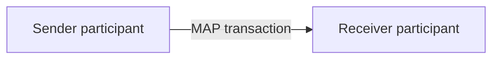

# 2.6.1 Basic Two-Party Transaction

The arrow represents the shared activity. It does not assert that Sender and Receiver are the only software components involved.

This concept is part of the reusable MAP architecture; its detailed exchange obligations arise only where the Framework and an applicable transaction specification expressly assign them. In a UC IG, use-case choices are documented in the relevant UCTXDef rather than inferred from illustrative architecture.
